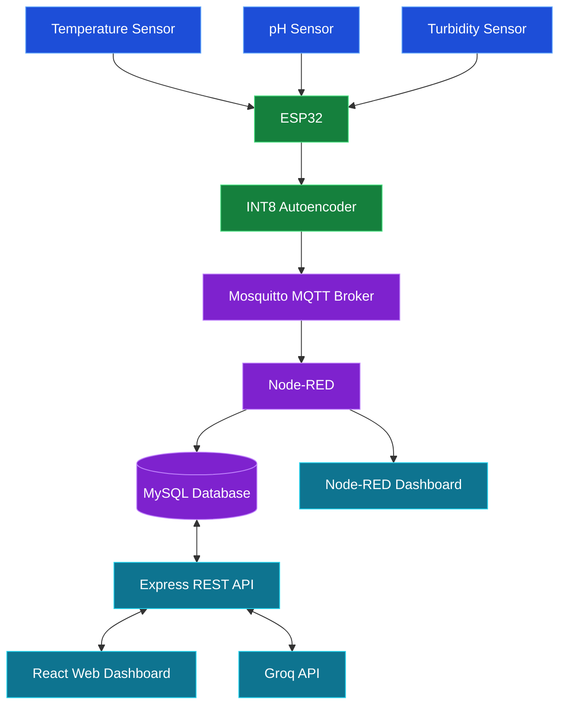
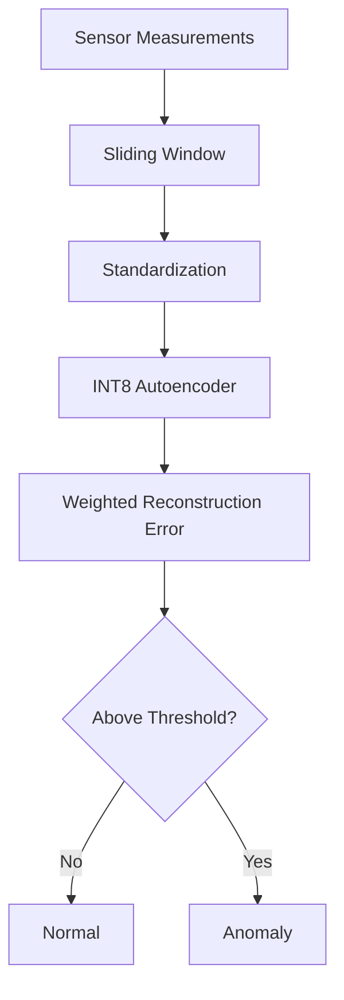
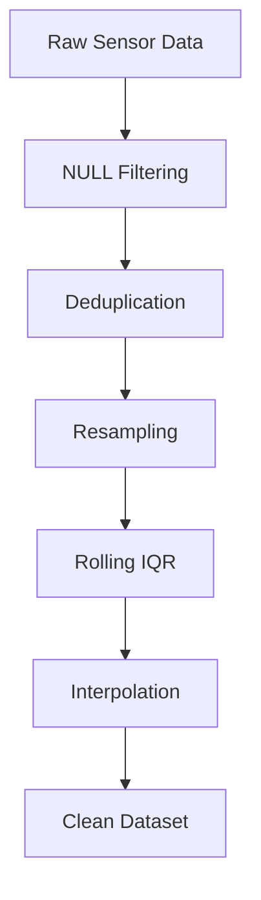

<h1 align="center">💧 Water Quality Monitoring System</h1>
<strong>Real-time water quality monitoring with IoT and Edge AI</strong>

  
  
  
  
  

  
  
  
  
  

  
  

  <a href="#overview">Overview</a> · <a href="#features">Features</a> · <a href="#system-architecture">Architecture</a> · <a href="#edge-ai">Edge AI</a> · <a href="#getting-started">Getting Started</a> · <a href="#roadmap">Roadmap</a>

Overview
An end-to-end IoT water quality monitoring project combining embedded sensor acquisition, MQTT communication, automated data preprocessing, and on-device anomaly detection. An ESP32 processes temperature, pH, and turbidity measurements using an INT8 Autoencoder, while server-side services support storage, visualization, and AI-assisted analysis.
Features
- Real-time temperature, pH, and turbidity monitoring
- On-device anomaly detection with TensorFlow Lite Micro
- MQTT-based sensor telemetry
- Multi-device monitoring and historical visualization
- Automated sensor data cleaning and preprocessing
- MySQL storage and Express API
- Web dashboard and AI-assisted analysis
System Architecture

Technology Stack
Layer	Technologies
Firmware	ESP32, ESP-IDF, C/C++
Edge AI	TensorFlow Lite Micro, INT8 quantization
Model training	Python, TensorFlow, Keras
Communication	MQTT, Mosquitto
Data processing	Node-RED, JavaScript
Database	MySQL
Backend	Node.js, Express
Frontend	React, Vite
AI assistant	Groq API
Infrastructure	Docker Compose

Hardware
Component	Purpose
ESP32	Sensor acquisition, inference and communication
DS18B20	Water temperature measurement
pH sensor	Acidity measurement
Turbidity sensor	Water clarity measurement

Edge AI
The firmware integrates an Autoencoder to detect abnormal patterns in sequential sensor measurements using reconstruction error.
Parameter	Specification
Model	Autoencoder
Features	Temperature, pH, turbidity
Window size	10 samples
Input shape	10 × 3
Quantization	INT8
Inference engine	TensorFlow Lite Micro
Target	ESP32

Evaluation focuses on precision, recall, F1-score, false positive rate, model size, and inference latency. On-device performance requires separate benchmarking.
Data Processing

Repository Structure
The project is organized around the following components:
water-quality-monitoring-system/
├── firmware/          # Embedded firmware
├── ai/                # Model training and Edge AI
├── backend/           # Backend API
├── frontend/          # Web dashboard build
├── infrastructure/    # Deployment configurations
├── database/          # Database schema
├── data/              # Approved datasets
├── docs/              # Technical documentation
├── .gitignore
└── README.md
Getting Started
Clone the repository
git clone https://github.com/thanhzkx/water-quality-monitoring-system.git
cd water-quality-monitoring-system
Prerequisites
- ESP-IDF for firmware development
- Python 3 for model training
- Node.js and npm for backend development
- Docker and Docker Compose for infrastructure
Full deployment instructions are under development. The recovered frontend build is not a substitute for the original editable React source. Configure local credentials and review service settings before deployment.
Security
Do not commit production credentials, API keys, private datasets, database backups, or runtime files. Security hardening remains in progress, including MQTT access control, TLS, parameterized SQL queries, input validation, and device-level authorization.

This project is a monitoring prototype. Sensor measurements and anomaly predictions alone cannot establish that water is safe to drink.
Roadmap
- [x] Sensor data acquisition firmware
- [x] MQTT integration
- [x] Database integration and preprocessing logic
- [x] Autoencoder training and INT8 conversion
- [x] Edge AI firmware integration
- [x] Monitoring dashboard implementation
- [ ] Verify reproducible deployment
- [ ] Restore or reconstruct editable frontend source
- [ ] Security hardening
- [ ] On-device performance benchmarking
- [ ] Automated testing
- [ ] Complete technical documentation
Author
Nguyen Minh Thanh —  Ho Chi Minh City University of Technology (HCMUT).

GitHub — thanhzkx

Built with Embedded Systems, IoT and Edge AI.
